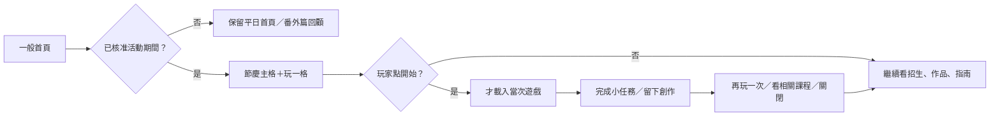

# 節日番外篇：動遊系首頁原創互動企畫

2026-10-22，TF-GO／Codex。狀態：研究與企畫，沒有實作遊戲、沒有修改本機首頁，也沒有上線。文件分支codex/holiday-plan；網站開發仍以三語審閱版為脈絡，不能把本文件分支或舊遊戲分支整條拿去發布。

## 先做什麼

建議系列名稱「節日番外篇」，首頁按鈕用「玩一格」。參考Google的是節日策展、清楚入口及舊作回顧，不採其角色、美術、聲音、程式、關卡或辨識性規則組合。

先列8個2027候選，選1款本機試點，體驗確認後才排其餘檔期。第一款建議「燈影借位」：利用現有漫畫格，把燈、物件和影子組成一個可操作的小舞台，與系上動畫、構圖和場景課程直接連結。若希望先做有放假的節日，可改選春節「年獸表演課」。原型日期與預算尚未承諾。

使用者2026-10-22已於對話確認三題：6–8個台灣節日，加系上畢展／開學；30–90秒，結合動畫、遊戲與漫畫創作；節日期間更換首頁主視覺，點擊才開始，平時可回顧。以下列8個候選供挑選；具體首款及各款玩法尚未確認。30–90秒是本案目標，不是Google官方標準。

## 使用者會看到的流程

- AGD品牌、導覽、招生與在校指南一直可用；不自動彈窗或把原PRESS START功能直接取代掉。
- 點「玩一格」才載入遊戲；聲音預設關閉。單指或鍵盤皆可操作，拖曳有點選替代方式。
- 隨時關閉，停止音訊與計時，回到原位置及開始按鈕。減少動態偏好也要作用於遊戲內部。
- 活動結束恢復平日主格；「節日番外篇」保存年份、原活動期間、玩法和創作團隊。回顧不是當期活動公告。

## 8個候選，先選1款驗手感

日期已按[人事總處2027公告](https://www.dgpa.gov.tw/information?pid=12983&uid=2)、[官方國農曆年曆](https://www.dgpa.gov.tw/information?pid=13114&uid=55)與[現行條例](https://law.moj.gov.tw/LawClass/LawAll.aspx?pcode=D0020095)核對。下表只列節日正日；政府假期、補假和學校停課不得混用。學校實際行事曆仍待核對。

| 正日 | 題材／原創工作名 | 玩家實際做什麼 | 完成回饋與系所連結 | 優先度 |
|---|---|---|---|---|
| 2027/1/1 元旦 | 明年的第一格 | 調整3張關鍵格的停留時間，讓主角跨進新年時動作連貫 | 播放自己排出的短動畫；認識動畫時間與節奏 | 延伸 |
| 2027/2/6 春節初一 | 年獸表演課 | 用眉、眼、嘴及姿勢選項，替原創年獸演出「驚喜→開心→拜年」；不是辨識真人情緒 | 完成一段年獸表演；連到角色設計與動畫課程 | 首批 |
| 2027/2/20 元宵 | 燈影借位 | 移動燈的位置與三件舞台物，讓它們的投影合成指定燈面圖案；不是拼圖碎片貼合 | 燈面點亮並演成兩格影戲；連到構圖、光影與場景 | 試點首選 |
| 2027/4/4 兒童節 | 玩具聲音偵探 | 觀察3段玩具動畫，選擇合適材質聲並安排發聲時點；靜音模式以文字與脈衝代替 | 播出自己的短片；認識擬音與聲畫同步 | 延伸 |
| 2027/6/9 端午 | 粽葉折疊局 | 按指定摺線順序折虛構葉片，將紙上餡料輪廓包住；可展開重試 | 得到個人選色的紙藝粽造型；認識空間、摺疊與造型 | 首批 |
| 2027/9/15 中秋 | 月光剪接台 | 在月亮與下一鏡的圓形物件間選剪接點，調整畫面位置，做出形狀和動作銜接 | 播放一段月夜match cut；連到分鏡及影音剪輯 | 首批 |
| 2027/9/28 教師節 | 老師，這格謝謝你 | 在3格漫畫裡選角色動作、對白出現順序和停頓，完成一段道謝場景 | 得到可重播的感謝漫畫；連到劇本、師資與學生作品 | 延伸 |
| 2027/10/10 國慶 | 島嶼場景工作室 | 調整近景／中景／遠景層次及鏡頭移動，讓原創台灣日常場景保有指定視線與主角可見性 | 生成一段城市到海岸的短鏡頭；連到場景與鏡頭設計 | 延伸 |

「首批」表示優先評估，不代表一次製作三款或已准許公開。原創工作名與玩法均為本輪提案，沒有宣稱全球首創。粽葉題目是虛構紙藝解題，不當成真實包粽教學；角色及地方圖像另做人文與視覺審閱。

日期提醒：2027春節政府機關假期為2/4–2/10，初一是2/6；元宵2/20本身不另放假，當日恰逢週六；端午6/9、中秋9/15為週三，教師節9/28為週二，不能硬湊連假。兒童節正日4/4與政府補假4/6分開標示。[政府日曆公告](https://www.dgpa.gov.tw/information?pid=12983&uid=2)

## 近期備選與不固定日期

- 2026/12/25可作「冬夜場景工作室」的試點備選：用分層構圖與視線提示完成冬夜場景。這是國慶場景工具的題材備案，**不是第9款已承諾遊戲**；要採用需替換當期計畫。法定放假名是行憲紀念日；冬日／聖誕是另外選的文化視覺主題，不寫成因聖誕而全國放假。
- 不為2026/10/25趕做遊戲；研究日距節日僅3天，沒有原型與測試證據。
- 開學／迎新可做校園尋路與指南導覽；畢展可做作品接力。兩者日期留null，由校曆、當屆公告和作品授權確認後才排，不寫死每年9月或5月。
- 母親節、父親節、七夕、萬聖節、聖誕文化檔期及原住民族主題為第二階段另評估，不等於全體學生放假。
- 和平紀念日、終戰紀念日、國家防災日不套歡樂搶分模板；可採安靜閱讀、記憶探索或正確防災情境。這是策展取向，不是法律禁止。清明另以家庭記憶為主，不和兒童節遊戲混成祭祖競技。

## 與Google比較：必須改的是規則，不只題材

以下G01–G08對應[Google第一手研究](research-google-doodles.md)。它們是目前先行比較的案例，尚未證明已涵蓋所有Google作品；實作前仍要尋找每款真正最相近者，補做可玩版本並排比較。

| 提案 | 本輪對照 | 目標與規則差異 | 明確不用的組合 |
|---|---|---|---|
| 明年的第一格 | G06數位卡片 | 調整格間時間，完成可觀察的動作連續性；不是貼紙構圖卡片 | 不用同款手作桌面、剪紙材料及卡片布局 |
| 年獸表演課 | G01魔法貓 | 選姿勢與表情通道，排出角色表演；不依敵人符號畫招式 | 不用貓／幽靈／逼近敵人／畫符消滅的循環 |
| 燈影借位 | G02披薩空間題 | 改光源與前後位置，使投影重合；沒有訂單配料、切片數或切割評星 | 不把披薩換燈籠或月餅後照切 |
| 玩具聲音偵探 | G05嘻哈創作 | 以畫面材質和動作時點安排擬音，完成聲畫同步 | 不用雙唱盤、唱片箱、刮盤介面及歷史取樣 |
| 粽葉折疊局 | G02空間題、G03物理互動 | 改變摺面與遮蓋關係，展開再折；沒有切片訂單或拋射距離 | 不切月餅配料，不用投石機拋粽子挑戰最遠 |
| 月光剪接台 | G04指令組合 | 對照相鄰兩鏡的形狀位置與動作方向選剪接點；不是角色按程式走格撿物 | 不用積木指令列、紅蘿蔔路徑與相同六關 |
| 老師，這格謝謝你 | G06數位卡片 | 對白、動作、留白構成短故事；完成一段閱讀節奏而非材料拼貼 | 不用相同卡片素材與桌面，老師肖像另須確認 |
| 島嶼場景工作室 | G08大型島嶼 | 一幕的景深、遮擋與鏡頭構圖解題；無大地圖探索、運動關卡或隊伍競賽 | 不複製島嶼地圖、七運動、卷軸或四隊排名 |

實作前逐款填10欄矩陣：參考案例、玩家目標、核心動詞、規則狀態、完成回饋、關卡節奏、節日不可替代性、系所連結、美術／敘事／聲音、實際並排比較。若移除美術後仍是同一套關卡與得分循環，就退回設計。這是設計審查，不是法律鑑定或全球唯一性保證。

## 第一款「燈影借位」的最小可玩規格（提案）

1. 首頁只顯示一格原創燈影海報與「玩一格」；不自動下載遊戲。
2. 點開始先看一張目標剪影。玩家用單指或方向鍵調整燈位，再選兩到三件舞台物的前後位置。
3. 第一題只改燈位；第二題加入遮擋；第三題加入兩個物件共同投影。題型與數值須原型驗證，現在沒有完成的題庫。
4. 投影接近目標時以輪廓／位置標記回饋；不只靠顏色。完成後演出兩格影戲，不要求登入或分享。
5. 「再借一個角度」「認識動畫與場景課程」「回首頁」三條出口。首次目標30–90秒，由新手實測驗證，不拿開發者通關時間當證據。
6. 原型先測可理解性與手感，再決定光影計算方式及引擎。現在不預先承諾真3D、檔案KB、FPS或開發天數。

## 排程與維護

規格欄位分開記：節日正日calendarDate、法定假性質holidayType、政府休假governmentClosure、學校停課schoolClosure、網站displayFrom／displayUntilExclusive。用Asia/Taipei，農曆節日每年核對；學校欄未知填null。

每款獨立ID與資源manifest，共用開始／結束／靜音／三語外框，遊戲規則及角色另外設計。活動重疊時只顯示一款，採人工優先序；春節與元宵雖近，不以為年度8提案就必須短期連做兩款。初期不設帳號、雲端排名、麥克風或學生個資蒐集。

建議顯示期間：節日前3天開始、節日後1天結束；春節可另依正式假期及編輯決策延長。這是待確認的網站策展設定，不是放假規定，也不是已開啟的自動排程。

遊戲UI與正式美術遵循專案核准生圖管線，UI使用Codex生圖；不能直接拿Google圖、音效、Logo或程式，也不以程序面板冒充正式遊戲介面。先做原創角色／畫風／操作草稿供使用者審，再製作與驗收；本輪沒有生成美術或實作灰盒。

## 工程前置與公開界線

現有Hero、三語父頁及舊PlayCard的點擊載入模式可以參考，但節日排程、遊戲三語、Esc／焦點、卸載停聲都尚未實作。[程式實讀與14項驗收](research-homepage-feasibility.md)

先做P0發行包隔離：現有Build會複製未排除的根目錄，並保留舊dist；把入口藏起來不能證明遊戲未發布。未來用全新發行目錄、明確檔案白名單與負向清單驗證，保留舊輸出以遵守不刪檔。正式包不得包含未授權既有遊戲、work-orders研究工單或preview強制參數能力。這是研究發現的必要前置，**本輪沒有修改Build**。

後續步驟：主任選首款與呈現方式 → 原創規則／美術草稿 → 單款本機可玩 → 新手與三語／手機測試 → 主任體驗確認 → 如另獲公開授權才準備正式包。這份企畫不授權上線，仍不push、不碰main、不刪檔、不動C節。

## 本輪文件驗收

實際結果另見VERIFY-plan.md；僅驗研究／企畫資料、日期一致性、來源引用、離線狀態頁及範圍保護。網站Build、遊戲通關、實體手機與玩法原創實測均未執行，因本輪只規畫。
