# 在校指南

在校生必讀｜動遊系修業生存指南

先查自己的入學年度，再照流程找對窗口

查核基準日：2026-10-22（台灣）。對象：動畫與遊戲設計系四技日間部在校生；以一般班為主要對象，技優班另列警示。本稿只供老師審閱，未發布。

## 先分清楚三件事

1. 當年度公告與入學年度規定不同：選課／獎助看當期；畢業課表先對自己的入學年度與班別。
2. 官方PDF全文已讀，與搜尋索引可讀但即時403／202空內容，分開標示。後者不宣稱已核實為現行全文。
3. 查不到的期限、表單、認列名單與程序保留待確認，不以別系、他校或舊規定補齊。

## 入學年度重點

| 一般日四技入學年 | 最低總學分 | 校外實習 | 專業證照 | 外系專業選修採計上限 | 官方表 |
|---|---:|---:|---:|---:|---|
| 112 | 128 | 160小時 | 至少1張 | 16學分 | [課程表p1](https://info.stu.edu.tw/ACA/teacher/QryCoursedept/DownLoadFileori.asp?Sec=112116) |
| 113 | 128 | 160小時 | 至少1張 | 20學分 | [課程表p1](https://info.stu.edu.tw/ACA/teacher/QryCoursedept/DownLoadFileori.asp?Sec=113116) |
| 114 | 128 | 160小時 | 至少1張 | 20學分 | [課程表p1](https://info.stu.edu.tw/ACA/teacher/QryCoursedept/DownLoadFileori.asp?Sec=114116) |
| 115 | 128 | 160小時 | 至少1張 | 20學分 | [課程表p1](https://info.stu.edu.tw/ACA/teacher/QryCoursedept/DownLoadFileori.asp?Sec=115116) |

114「3D動畫新媒體技優專班」與115「AI多媒體創新設計技優專班」的p2另列1學程、2張電腦資訊相關專業證照、技術精進學程10學分；但其備註援引「資訊管理系」門檻文件，須由系辦確認，不將疑似範本條文直接寫成一般班規定。

## 我離畢業還差什麼？

先對入學年度與班別，再查系統檢核；總學分夠不等於所有門檻都過。

適用入學年：本稿已核對112至115入學課表；其他入學年、轉學生、延修生須另核。

班別差異：一般班以各入學年課表為準；114、115技優班另有條件，表內疑義待系辦確認。

- 112至115入學一般日四技的已讀課程表均列最低128學分，分為校必修31、院必修8、系必修44、系選修45。
- 一般班另有校外實習160小時、至少1張專業證照、英文能力及專題等要求；零學分必修也不能漏。
- 外系專業選修採計上限：112入學16學分，113至115入學20學分。技優班有另列條件，不能套用一般班。

建議辦理順序（白話整理，非代替正式表單）：

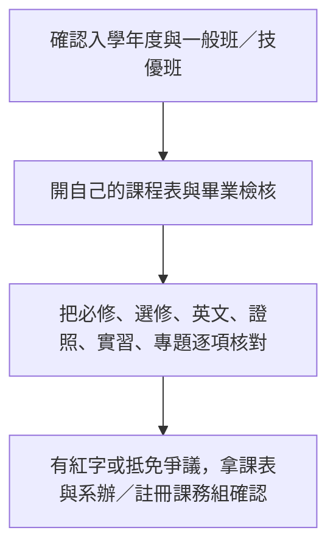

準備資料：本人歷年成績與畢業檢核；本人入學年度課程表；證照與實習認列結果。

期限與現況：每學期選課前自查一次；畢業前還需完成正式審核與離校。

找誰：動遊系辦，07-6158000#6102；教務處註冊課務組（動遊系），07-6158000#2016。

來源：[教務處歷年各系課程規劃表](https://info.stu.edu.tw/ACA/teacher/QryCoursedept/qrydeptCourse.asp?lt=1)、[動遊系112學年度四技日間部入學生課程表](https://info.stu.edu.tw/ACA/teacher/QryCoursedept/DownLoadFileori.asp?Sec=112116)、[動遊系113學年度四技日間部入學生課程表](https://info.stu.edu.tw/ACA/teacher/QryCoursedept/DownLoadFileori.asp?Sec=113116)、[動遊系114學年度四技日間部入學生課程表](https://info.stu.edu.tw/ACA/teacher/QryCoursedept/DownLoadFileori.asp?Sec=114116)、[動遊系115學年度四技日間部入學生課程表](https://info.stu.edu.tw/ACA/teacher/QryCoursedept/DownLoadFileori.asp?Sec=115116)、[115-1休學退學注意事項](https://www.stu.edu.tw/latestnews-single/?id=233836)。

待老師確認：

- 請系辦確認現行認列證照清單、零學分必修檢核項目及延修／轉學等特殊適用規則。
- 114/115技優班備註援引資訊管理系門檻文件，疑為範本沿用，須確認正式適用規則。

## 想去實習，先做哪一步？

先找系辦確認認列與合約，再開始實習；一般打工不要先假設能抵實習。

適用入學年：本稿已核對112至115入學課表；其他入學年、轉學生、延修生須另核。

班別差異：一般班以各入學年課表為準；114、115技優班另有條件，表內疑義待系辦確認。

- 112至115一般日四技課程表列校外實習2學分、160小時。
- 學校有校外實習線上合約系統，職發中心協助合約及實習保險。
- 公司、工作內容、指導老師與報告格式，以動遊系當年度實習規定為準。

建議辦理順序（白話整理，非代替正式表單）：

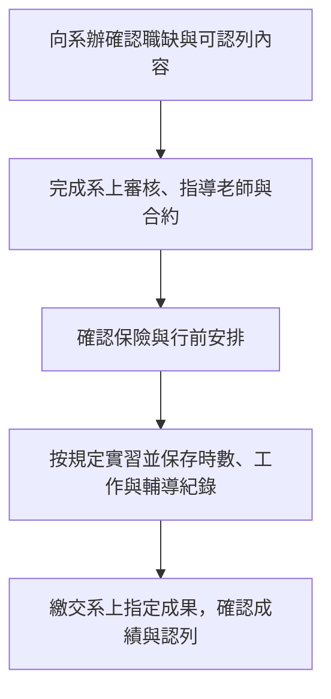

準備資料：合約、個別計畫及保險資料：依最新版系辦清單準備；實習時數與成果文件：格式待系辦確認。

期限與現況：開始前完成認列、合約及保險確認；本系當期申請截止日尚未查得。

找誰：動遊系辦／實習指導老師，07-6158000#6102；研發處職涯發展暨校友服務中心（實習），07-6158000#1711。

來源：[動遊系112學年度四技日間部入學生課程表](https://info.stu.edu.tw/ACA/teacher/QryCoursedept/DownLoadFileori.asp?Sec=112116)、[動遊系113學年度四技日間部入學生課程表](https://info.stu.edu.tw/ACA/teacher/QryCoursedept/DownLoadFileori.asp?Sec=113116)、[動遊系114學年度四技日間部入學生課程表](https://info.stu.edu.tw/ACA/teacher/QryCoursedept/DownLoadFileori.asp?Sec=114116)、[動遊系115學年度四技日間部入學生課程表](https://info.stu.edu.tw/ACA/teacher/QryCoursedept/DownLoadFileori.asp?Sec=115116)、[職發中心業務與成員](https://dcpi.sao.stu.edu.tw/業務介紹-成員/)、[校務公開網：校外實習制度說明](https://public.stu.edu.tw/校務資訊說明/學校特色與發展願景/學校特色說明/)。

待老師確認：

- 最新版動遊系實習實施要點、實習表單、是否可自找廠商、校外打工能否認列、遇爭議或中止的程序，均待系辦確認。

## 證照要認列，考試費能補助嗎？

畢業認列與獎助金是兩件事；不要只上傳證照就以為兩邊都完成。

適用入學年：本稿已核對112至115入學課表；其他入學年、轉學生、延修生須另核。

班別差異：一般班以各入學年課表為準；114、115技優班另有條件，表內疑義待系辦確認。

- 一般日四技課程表列至少1張專業證照；可用哪一張仍須對系上清單。
- 2026年8月官方公告說明：獎助限在籍期間考取，申請原則為證照生效半年內；入學前證照只認列、不獎助。
- 獎助須自行送件，已有老師團體登錄的證照，仍可能要追加獎助申請；先備好本人匯款帳戶。

建議辦理順序（白話整理，非代替正式表單）：

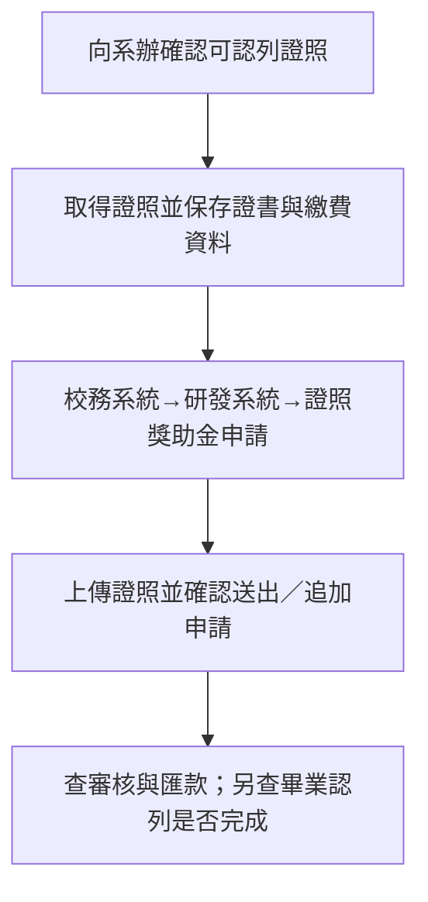

準備資料：證照電子檔；考試報名費相關資料依系統要求；學生本人匯款帳戶資料。

期限與現況：官方114-2獎助公告：證照生效日半年內；115-1是否另有修正待確認。

找誰：動遊系辦（認列），07-6158000#6102；研發處職發中心（獎助），07-6158000#1713。

來源：[動遊系115學年度四技日間部入學生課程表](https://info.stu.edu.tw/ACA/teacher/QryCoursedept/DownLoadFileori.asp?Sec=115116)、[114-2學期證照獎助金申請公告](https://www.stu.edu.tw/latestnews-single/?id=233658)。

待老師確認：

- 系上認列清單、替代措施及115-1最新獎助規則尚未取得完整現行版。
- 114/115技優班表另列2張電腦資訊相關證照與1學程，不可只讀一般班1張規定。

## 不能到課，請假怎樣才算完成？

送出假單還不等於核准；先通知老師，再看系統最後的簽核結果。

適用入學年：當期公告適用資格須逐案核對，不因入學年自動取得資格。

班別差異：一般班與技優班如有專班或身分差異，須依承辦單位規定確認。

- 2026年6月公告：1日內一般假別由導師線上核准；2日以上需導師、系主任及後續權責簽核。
- 一般假別送出後若導師或系主任逾5日未簽核，公告記載系統視為不同意；要主動追蹤。
- 2019文件與2026公告的流程已有差異；考試週、長假、補請期限與心理假不可照舊表直接套用。

建議辦理順序（白話整理，非代替正式表單）：

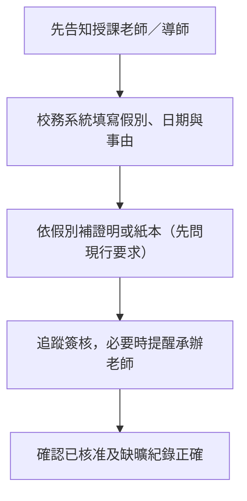

準備資料：依假別要求的證明；確切項目待最新版請假規則確認；考試週另問授課老師及生輔組。

期限與現況：最晚補請天數及考試週紙本期限未核實現行版；不要把舊PDF的數字當保證。

找誰：導師／生活輔導組，07-6158000#2114；考試相關另洽教務處註冊課務組，07-6158000#2016。

來源：[學生請假與獎懲簽核公告](https://www.stu.edu.tw/latestnews-single/?id=213183)、[學生請假規則（舊PDF）](https://wpc.stu.edu.tw/wp-content/uploads/sites/38/2019/10/E6A8B9E5BEB7E7A791E68A80E5A4A7E5ADB8E5ADB8E7949FE8AB8BE58187E8A68FE58987-E8A18CE6B1BA.pdf)、[生活輔導組組織與職掌](https://life.sao.stu.edu.tw/en/單位介紹/組織與成員/)。

待老師確認：

- 請提供最新版學生請假規則與系統操作；病假、事假、喪假、公假、考試週、心理假及補請期限仍需逐項確認。

## 選錯課、必修漏選，現在怎麼辦？

選課以系統紀錄為準；去上課或請老師答應，不代表已選上。

適用入學年：當期公告適用資格須逐案核對，不因入學年自動取得資格。

班別差異：一般班與技優班如有專班或身分差異，須依承辦單位規定確認。

- 選課通常分初選、開學加退選、學期中棄選；每一階段目的不同。
- 115-1加退選官方公告是2026/9/7 10:00至9/14 09:00；查核日已過，不能當成現在仍開放。
- 先核對必修、學分上下限及衝堂；超修、減修另須完成申請，核准後仍要自己處理選課。

建議辦理順序（白話整理，非代替正式表單）：

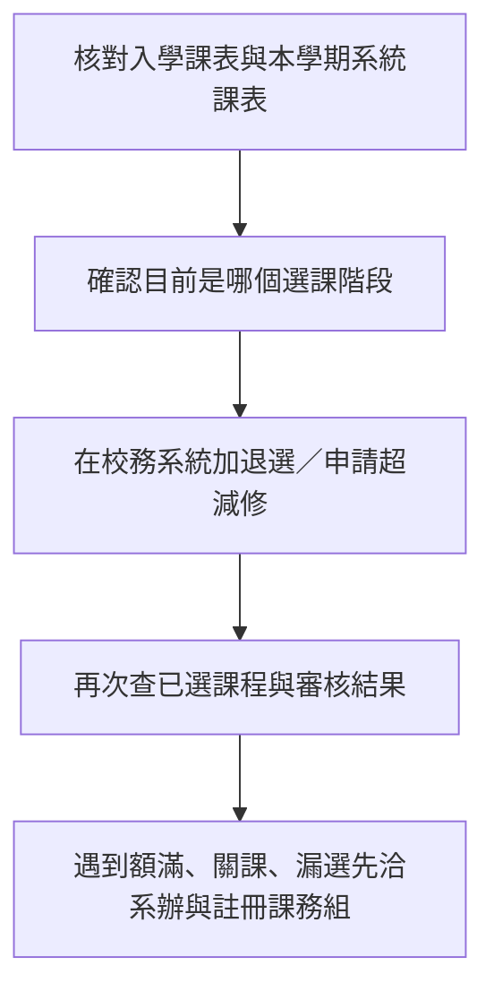

準備資料：本學期課表；必修需求與歷年成績；超減修等特殊申請資料（依系統）。

期限與現況：115-1加退選已截止；本學期棄選的確切開放日期尚未查得。

找誰：動遊系辦／註冊課務組，07-6158000#2016；course@stu.edu.tw。

來源：[115-1加退選公告](https://www.stu.edu.tw/latestnews-single/?id=233791)、[教務處常見問答](https://www.aca.stu.edu.tw/常見問題｜qa/)。

待老師確認：

- 115-1棄選期間、人工補救是否適用與最新版學分上下限需再核對正式行事曆。

## 以前修過的課，能不能抵免？

抵免要申請、送審、查結果；初審過了也要留意原課表是否需要自行退選。

適用入學年：當期公告適用資格須逐案核對，不因入學年自動取得資格。

班別差異：一般班與技優班如有專班或身分差異，須依承辦單位規定確認。

- 115-1官方抵免申請期間是2026/8/3至9/21，查核日已截止。
- 校務系統填表後，要帶紙本表及相關成績證明正本送開課單位與就讀系所審核，再交註冊課務組複審。
- 免修與抵免不是同一件事；免修後可能仍須以其他課程補足畢業學分。

建議辦理順序（白話整理，非代替正式表單）：

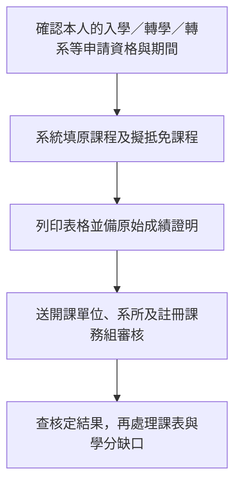

準備資料：抵免學分申請表；相關成績證明正本；必要的課程大綱（依審查單位要求）。

期限與現況：115-1申請已截止；不可承諾逾期補申請。

找誰：開課單位／動遊系辦／註冊課務組，07-6158000#2016；course@stu.edu.tw。

來源：[115-1學分抵免申請公告](https://www.stu.edu.tw/latestnews-single/?id=233794)、[教務處常見問答](https://www.aca.stu.edu.tw/常見問題｜qa/)。

待老師確認：

- 每一身分事由的申請次數與轉學等特殊案件，請註冊課務組依本人資格判定。

## 專題製作

做出作品只是其中一段；先問清楚該屆的審查、修課與繳件要求。

適用入學年：本稿已核對112至115入學課表；其他入學年、轉學生、延修生須另核。

班別差異：一般班以各入學年課表為準；114、115技優班另有條件，表內疑義待系辦確認。

- 已讀112至115一般班課表均將專題設計Ⅰ、Ⅱ列為必修，另有專業認證與實習等要求。
- 專題題目、指導老師、審查及成果文件依系上當屆辦法，不宜把招生介紹當正式畢業審查規則。
- 本次未取得動遊系專題現行辦法全文，不能先替同學填入組員人數、評分、口試或展覽期限。
- 已找到系上「常用表單」入口，但內嵌內容未能讀取；本屆專題辦法、審查時程與下載表單仍待系辦提供，不能用成果新聞代替。

建議辦理順序（白話整理，非代替正式表單）：

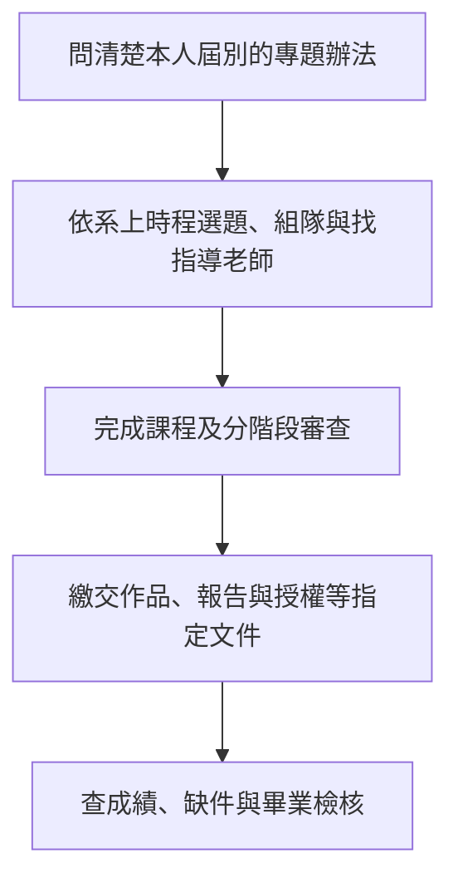

準備資料：當屆系上指定的企劃、作品、書面報告與成果資料；完整清單待確認。

期限與現況：當屆專題／畢展各階段截止日尚未取得，不填推測日期。

找誰：專題指導老師／動遊系辦，07-6158000#6102。

來源：[動遊系112學年度四技日間部入學生課程表](https://info.stu.edu.tw/ACA/teacher/QryCoursedept/DownLoadFileori.asp?Sec=112116)、[動遊系113學年度四技日間部入學生課程表](https://info.stu.edu.tw/ACA/teacher/QryCoursedept/DownLoadFileori.asp?Sec=113116)、[動遊系114學年度四技日間部入學生課程表](https://info.stu.edu.tw/ACA/teacher/QryCoursedept/DownLoadFileori.asp?Sec=114116)、[動遊系115學年度四技日間部入學生課程表](https://info.stu.edu.tw/ACA/teacher/QryCoursedept/DownLoadFileori.asp?Sec=115116)、[動遊系常用表單](https://www.dgd.stu.edu.tw/常用表單/)。

待老師確認：

- 最新版專題研究與展演辦法、組隊與退組規則、評分標準、補救措施及授權表，請老師確認。

## 英文課修完，就通過英文門檻了嗎？

英文課學分與英文能力門檻要分開查；抵免也不代表總學分自動補足。

適用入學年：本稿已核對112至115入學課表；其他入學年、轉學生、延修生須另核。

班別差異：一般班以各入學年課表為準；114、115技優班另有條件，表內疑義待系辦確認。

- 114、115一般日四技課表仍列校訂英文能力門檻。
- 四技日間部英文與外語課合計8學分；入學年度、分級與免修結果會影響實際修課。
- 2023官方說明曾列英檢或替代方案；2026是否修正分數、認列項目及替代方案，尚未取得現行規則，不把考照獎助金的分數當畢業分數。

建議辦理順序（白話整理，非代替正式表單）：

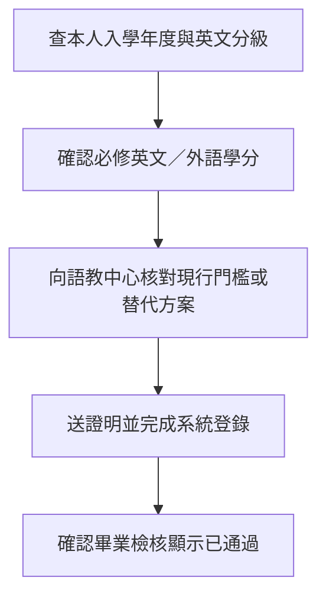

準備資料：英檢成績單或替代方案的修課與考試紀錄；畢業檢核畫面。

期限與現況：畢業前完成認列；每學期認列申請與替代課程期限需問語教中心。

找誰：語文暨國際教學中心／通識教育中心，07-6158000#4204；一般修課亦可洽通識教育中心，07-6158000#4202。

來源：[動遊系114學年度四技日間部入學生課程表](https://info.stu.edu.tw/ACA/teacher/QryCoursedept/DownLoadFileori.asp?Sec=114116)、[動遊系115學年度四技日間部入學生課程表](https://info.stu.edu.tw/ACA/teacher/QryCoursedept/DownLoadFileori.asp?Sec=115116)、[通識英文及外語修課](https://www.zzd.stu.edu.tw/通識英文及外語修課/)、[四技日間部英文畢業門檻注意事項](https://www.lcc.stu.edu.tw/2023/02/20/【重要】四技日間部學生請詳閱英文畢業門檻相關/)。

待老師確認：

- 最新英文門檻辦法、各測驗分數、證明效期與替代方案清單；語教中心實際承辦分機也請再確認。

## 休學復學與兵役

先確認學籍與兵役，不要只停止上課；退費日期也可能受手續完成時間影響。

適用入學年：當期公告適用資格須逐案核對，不因入學年自動取得資格。

班別差異：一般班與技優班如有專班或身分差異，須依承辦單位規定確認。

- 115-1休退學官方公告期間為2026/6/23至2027/1/4，須於學校上班日辦理。
- 本人或受託人領表登記後，須在含當日7日內完成離校及文件；逾期需重新登記，退費基準也重算。
- 復學、延畢、轉入或轉系等兵役事項需另問生輔組；不要因辦好學籍就假設兵役資料也完成。

建議辦理順序（白話整理，非代替正式表單）：

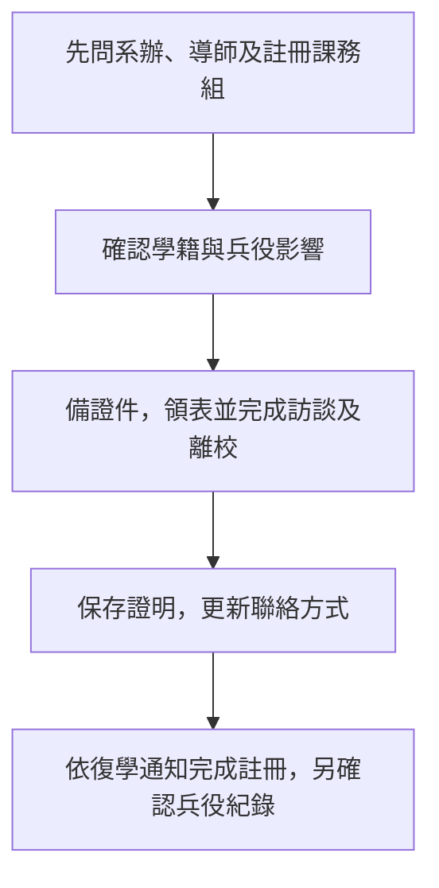

準備資料：學生證；委託代辦者需委託書；休復學原因與相關證明依現行表單；有兵役事項者依生輔組指定文件。

期限與現況：官方115-1公告所列期間；請再次確認是否另有異動及當日是否上班。

找誰：註冊課務組（動遊系），07-6158000#2016；生活輔導組（兵役，請轉接承辦）。

來源：[115-1休學退學注意事項](https://www.stu.edu.tw/latestnews-single/?id=233836)、[學校最新公告列表](https://www.stu.edu.tw/latestnews/)。

待老師確認：

- 個人役男身分與緩徵／儘召，請學校承辦確認；未核實兵役新公告之期限及分機。

## 學費或生活費突然不夠，找誰？

一般助學與急難救助是不同方案；先讓窗口幫你辨別，不要因某項截止就以為全部不能申請。

適用入學年：當期公告適用資格須逐案核對，不因入學年自動取得資格。

班別差異：一般班與技優班如有專班或身分差異，須依承辦單位規定確認。

- 115-1不利處境助學頁列10/20截止，低收入戶學產基金頁列10/8截止；截至2026/10/22都已過，不標示為仍開放。
- 突發家庭、傷病或其他困難，先詢問急難窗口適合的方案與送件期限。
- 各獎助可能限制重複請領，並須完成本人匯款帳戶資料；實際資格、金額與文件以方案公告為準。

建議辦理順序（白話整理，非代替正式表單）：

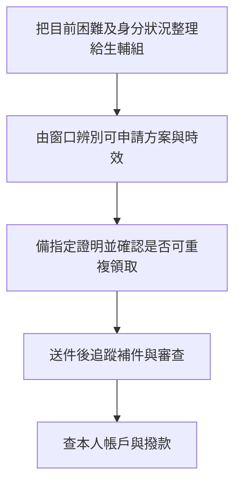

準備資料：各方案申請表；身分／戶籍／收入或急難事由等證明（依方案）；本人匯款帳戶資料。

期限與現況：不利處境助學2026/10/20及學產低收2026/10/8已截止；急難依個案方案，不共用這兩個期限。

找誰：生輔組急難慰助，07-6158000#2124；獎助學金／學雜費減免，07-6158000#2140。

來源：[115-1不利處境學生助學辦理須知](https://life.sao.stu.edu.tw/不利處境學生助學/辦理須知-2/)、[115-1教育部學產基金低收入戶助學金須知](https://life.sao.stu.edu.tw/訊息公告/)、[急難慰助專區撥款方式](https://life.sao.stu.edu.tw/急難救助/撥款方式/)、[生活輔導組組織與職掌](https://life.sao.stu.edu.tw/en/單位介紹/組織與成員/)。

待老師確認：

- 115-1各項現行收件狀態、補件政策與能否併領；官方低收頁第二學期顯示000年，暫不刊入具體日期。

## 壓力太大、被不當對待，該找誰？

諮商、性平與一般學權申訴是不同管道；先找到對的窗口，再談流程。

適用入學年：當期公告適用資格須逐案核對，不因入學年自動取得資格。

班別差異：一般班與技優班如有專班或身分差異，須依承辦單位規定確認。

- 學校在校學生入口列有線上預約諮商；可先透過該入口或請導師協助轉介。
- 性平會官方公務分機2145可洽詢轉接；學生案件的受理表單與現行程序仍需核實。
- 一般學權／成績爭議不要和性平調查混成同一流程；保存通知、日期、對話等相關資料，依案件找承辦單位。

建議辦理順序（白話整理，非代替正式表單）：

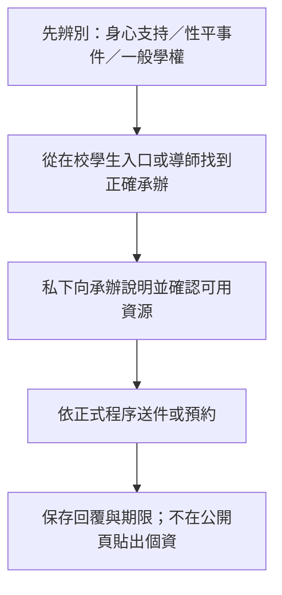

準備資料：一般諮商依預約表填寫；申訴／調查所需資料由承辦說明；草稿不收集個案內容。

期限與現況：諮商預約現行頁與各類學生申訴法定期限尚未取得完整現行版，不刊推測天數。

找誰：學務處身心支持相關單位（請由在校學生入口進入）；性別平等教育委員會（先洽詢轉接），07-6158000#2145。

來源：[學校在校學生入口](https://www.stu.edu.tw/在校學生/)、[115年度職場不法侵害調查公告](https://www.stu.edu.tw/latestnews-single/?id=233682)、[性平會活動官方聯絡資訊](https://infosys.stu.edu.tw/CampusAction/Action/GetActionDetail/9991AEBFBA16BA1C51F1223E876CFFF1A33FEC50CEE5F5B5)。

待老師確認：

- 校內諮商中心現行名稱、學生線上預約實際URL與承辦分機；學生申訴與性平現行辦法及正式窗口。

## 就業資源

先整理作品與履歷，再使用職涯中心資源，職缺與活動看當期。

適用入學年：當期公告適用資格須逐案核對，不因入學年自動取得資格。

班別差異：一般班與技優班如有專班或身分差異，須依承辦單位規定確認。

- 職發中心公務職掌包含UCAN職能檢測、職涯輔導、實習與徵才媒合、證照輔導。
- 不在草稿推薦已過期的徵才與活動；當期職缺、徵才會、學海計畫和研究所時程須另點原公告。
- 升學規劃已另列「繼續升學」，海外實習另列專卡，避免把不同申請流程混在一起。

建議辦理順序（白話整理，非代替正式表單）：

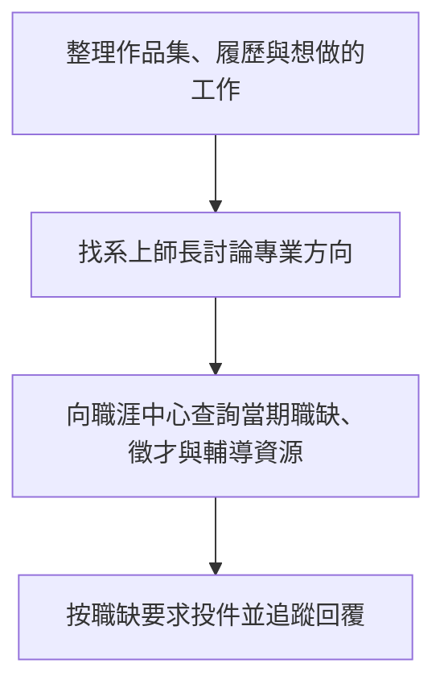

準備資料：作品集與履歷（準備建議）；各職缺、計畫與招生簡章指定資料。

期限與現況：依當期職缺、活動與招生簡章；沒有全校共用的單一截止日。

找誰：研發處職涯發展暨校友服務中心，07-6158000#1711；動遊系辦／相關領域老師，07-6158000#6102。

來源：[職發中心業務與成員](https://dcpi.sao.stu.edu.tw/業務介紹-成員/)、[動遊系課程介紹與系辦聯絡資訊](https://www.dgd.stu.edu.tw/english-系所介紹與課程地圖｜動遊系四年學什麼？/)。

待老師確認：

- 請職涯中心確認當期就業輔導、職缺與徵才活動入口。

## 繼續升學

先確認報考年度、資格與研究方向，再準備指定資料；各校各所的要求不同。

適用入學年：報考資格看招生年度與身分；本稿核對116碩甄，不限於特定入學年皆可先規劃。

班別差異：日四技一般班應屆生按簡章資格檢核；技優班及其他身分仍各自對照，不保證符合資格。

- 本卡提供升學規劃順序與本校116碩甄官方入口，不預設哪個研究所適合你。研究方向可先帶作品、專題或研究興趣與導師、專題指導老師討論；本系統一升學諮詢窗口尚待確認。
- 116簡章允許具學士資格或115學年度應屆畢業生等符合條件者報考；應屆生須交附表一並經教務單位核章，錄取後仍須取得學士資格才能註冊。
- 本校116碩甄網路填表與上傳期間：2026/9/29 10:00至11/2 16:00；部分境外學歷與專業資格同等學力身分另有10/27截止，不能一律套用11/2。
- 先對簡章各所指定的書審資料、口試規定與繳費期限；填完、上傳、繳費及確認送出都要核對，不把系統填表當報名完成。其他校系須另查該校116簡章。

建議辦理順序（白話整理，非代替正式表單）：

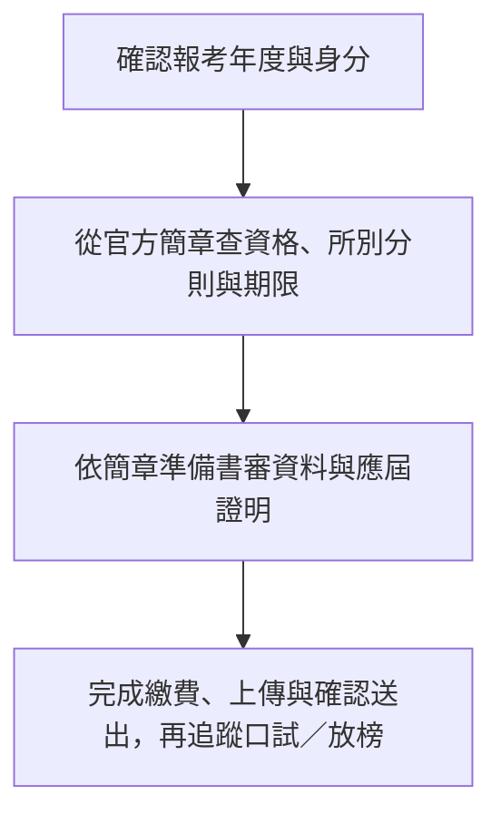

準備資料：報考校系當年度簡章；簡章指定學歷／應屆證明與成績資料；作品、研究或讀書計畫等僅在所別要求時繳交。

期限與現況：查核日2026/10/22，本校116碩甄一般網路報名期間尚未截止（11/2 16:00）；特殊資格可能10/27截止。其他校與管道另看自己的簡章。

找誰：教務處招生選才組（本校報名試務），07-6158000#2004、2015；導師／專題指導老師（規劃討論；統一窗口待確認）。

來源：[招生簡章查詢：116學年度碩士班甄試](https://info.stu.edu.tw/aca/newirs/qryIRSpdf/qryIRSCourse.asp)、[116學年度碩士班甄試招生簡章](https://info.stu.edu.tw/attachfile/upload/IRS/file/116A1.pdf)、[116碩士班甄試官方報名說明](https://info.stu.edu.tw/aca/NEWIRS/A1app.asp)、[動遊系課程介紹與系辦聯絡資訊](https://www.dgd.stu.edu.tw/english-系所介紹與課程地圖｜動遊系四年學什麼？/)。

待老師確認：

- 請系辦確認本系升學諮詢師長、說明會與可公開的輔導入口；不憑研究興趣自動推薦校系。

## 海外實習

先找當期計畫與甄選辦法，再確認資格、補助及合法出國文件；過往實習成果不是招生公告。

適用入學年：依當期計畫年級與學籍限制；現行教育部要點要求同教育階段就讀一學期以上。

班別差異：一般班與技優班均不保證錄取；非本國籍／無臺灣戶籍者不可據本卡推定符合學海補助資格。

- 動遊系2026年HC赴日實習新聞證明計畫曾辦理，曾採作品、專業能力與日文面試等遴選；尚未找到新一屆學生申請公告、名額、截止與固定語言級數。
- 學海補助由學校申請。教育部現行要點要求具中華民國國籍與臺灣戶籍、同教育階段在學一學期以上（不含在職專班），並通過校方專業及語言條件；境外生能否參與與是否能領此補助須分開確認。
- 學海實習通常須連續至少28日，印尼25日，交通日不算；補助與自付額須看核定契約，不能承諾人人補助或全額免費。期間須保有學籍且未休學。
- 學校需協助醫療、意外保險及符合實習地法令的簽證；由計畫主持人與承辦確認後辦理，不能預設觀光簽證可實習。
- 校內職涯中心成員頁明列1711承辦校外實習與學海計畫；本系計畫先問系辦／主持老師。國際及兩岸事務處提供交流入口，研發處最新分工尚未取得，不自行指定它受理。

建議辦理順序（白話整理，非代替正式表單）：

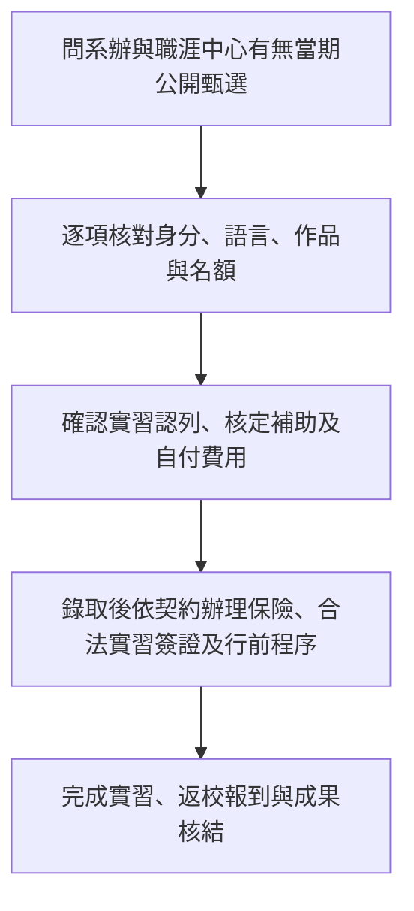

準備資料：當期甄選簡章與正式申請表（待取得）；依計畫要求的身分、在學、作品與語言證明；錄取後核定契約、保險、護照與適用簽證等文件。

期限與現況：未查得本系新一屆學生報名期限。115年第2次學海作業的9/30為學校送件期限，已過期；10至11月是教育部審查，不表示現在可報名。

找誰：動遊系辦／本系海外實習計畫主持老師，07-6158000#6102；職涯發展暨校友服務中心（學海業務），07-6158000#1711。

來源：[動遊系第九屆赴日HC實習成果](https://www.stu.edu.tw/latestnews-single/?id=223564)、[教育部出國研修或國外專業實習補助要點](https://edu.law.moe.gov.tw/LawContent.aspx?id=FL038574)、[115年學海計畫第2次甄選作業時程](https://www.studyabroad.moe.gov.tw/new/index/news.detail/sn/415)、[職發中心業務與成員](https://dcpi.sao.stu.edu.tw/業務介紹-成員/)、[國際及兩岸事務處：出國交流](https://www.oica.stu.edu.tw/出國交流/)、[動遊系課程介紹與系辦聯絡資訊](https://www.dgd.stu.edu.tw/english-系所介紹與課程地圖｜動遊系四年學什麼？/)。

待老師確認：

- 請確認下一屆正式簡章、名額、日語／其他語言要求、國籍與班別適用、補助與自付項目、表單及截止。
- 請確認系辦、職涯中心、國際處與研發處的現行分工，以及出國保險、簽證、緊急聯絡與返校認列流程。

## 待主任確認的五個問題

1. 114與115技優班課表引用資訊管理系文件是否為誤植？各班正式適用的學程、證照、實習與零學分必修為何？
2. 本系實習與證照最新辦法／表單為何？海外實習下一屆簡章、名額、語言、費用補助、簽證保險及系辦／職涯／國際／研發分工，請指定正式來源。
3. 請生輔組確認現行請假完整規則：補請、心理假、考試週，以及線上／紙本簽核如何分流？
4. 本屆專題製作與畢展的審查、補救、期限、表單及成果授權有無統一辦法？另請指定本系升學諮詢師長與輔導入口。
5. 請確認最新英文門檻與替代方案，以及諮商、學生申訴、性平受理的現行聯絡方式與公開連結。

## 來源存取紀錄

- **course-index**：[教務處歷年各系課程規劃表](https://info.stu.edu.tw/ACA/teacher/QryCoursedept/qrydeptCourse.asp?lt=1)。文件／頁面日期：頁面未標更新日；查核日2026-10-22。網頁全文可讀。逐筆點開動遊112、113、114、115連結確認學制及附件URL。
- **curriculum-112**：[動遊系112學年度四技日間部入學生課程表](https://info.stu.edu.tw/ACA/teacher/QryCoursedept/DownLoadFileori.asp?Sec=112116)。文件／頁面日期：2023-07-19；查核日2026-10-22。官方PDF已下載、渲染；一般班第1頁影像已讀，其餘班別不據此推論。一般班p1；114/115技優專班p2另有規範。附件回application/octet-stream，實為PDF。
- **curriculum-113**：[動遊系113學年度四技日間部入學生課程表](https://info.stu.edu.tw/ACA/teacher/QryCoursedept/DownLoadFileori.asp?Sec=113116)。文件／頁面日期：2024-08-30；查核日2026-10-22。官方PDF已下載、渲染；一般班第1頁影像已讀，其餘班別不據此推論。一般班p1；114/115技優專班p2另有規範。附件回application/octet-stream，實為PDF。
- **curriculum-114**：[動遊系114學年度四技日間部入學生課程表](https://info.stu.edu.tw/ACA/teacher/QryCoursedept/DownLoadFileori.asp?Sec=114116)。文件／頁面日期：2025-09-02；查核日2026-10-22。官方PDF已下載、渲染並逐頁影像檢視。一般班p1；114/115技優專班p2另有規範。附件回application/octet-stream，實為PDF。
- **curriculum-115**：[動遊系115學年度四技日間部入學生課程表](https://info.stu.edu.tw/ACA/teacher/QryCoursedept/DownLoadFileori.asp?Sec=115116)。文件／頁面日期：2026-08-26；查核日2026-10-22。官方PDF已下載、渲染並逐頁影像檢視。一般班p1；114/115技優專班p2另有規範。附件回application/octet-stream，實為PDF。
- **cert-award**：[114-2學期證照獎助金申請公告](https://www.stu.edu.tw/latestnews-single/?id=233658)。文件／頁面日期：2026-08（索引月份）；查核日2026-10-22。官方搜尋索引可讀；即時頁面403或202空內容，未核實搜尋索引後有無更新。屬114-2公告，期限以各張證照生效日計，不宣稱115-1規則未變。
- **leave-2026**：[學生請假與獎懲簽核公告](https://www.stu.edu.tw/latestnews-single/?id=213183)。文件／頁面日期：2026-06（索引月份）；查核日2026-10-22。官方搜尋索引可讀；即時頁面403或202空內容，未核實搜尋索引後有無更新。明載一般假別逾5日未簽核視為不同意；不可用舊PDF的2日流程替代。
- **leave-old**：[學生請假規則（舊PDF）](https://wpc.stu.edu.tw/wp-content/uploads/sites/38/2019/10/E6A8B9E5BEB7E7A791E68A80E5A4A7E5ADB8E5ADB8E7949FE8AB8BE58187E8A68FE58987-E8A18CE6B1BA.pdf)。文件／頁面日期：2019-10-16最後修正通過（PDF第1頁）；查核日2026-10-22。官方歷史PDF已下載，修正日期與第1頁影像已讀；不代表2026現行規定。共2頁；本輪僅以第1頁比對修正日期及舊簽核時限。與2026簽核公告不同，不作目前請假期限依據。
- **enrollment-115-1**：[115-1加退選公告](https://www.stu.edu.tw/latestnews-single/?id=233791)。文件／頁面日期：2026-09（索引月份）；查核日2026-10-22。官方搜尋索引可讀；即時頁面403或202空內容，未核實搜尋索引後有無更新。
- **credit-transfer-115-1**：[115-1學分抵免申請公告](https://www.stu.edu.tw/latestnews-single/?id=233794)。文件／頁面日期：115-1公告；頁面日期未取得；查核日2026-10-22。官方搜尋索引可讀；即時頁面403或202空內容，未核實搜尋索引後有無更新。
- **academic-faq**：[教務處常見問答](https://www.aca.stu.edu.tw/常見問題｜qa/)。文件／頁面日期：頁面未標修正日；查核日2026-10-22。官方搜尋索引可讀；即時頁面403或202空內容，未核實搜尋索引後有無更新。部分郵資等細節與2026公告有差異；近期公告優先，不直接沿用舊數字。
- **academic-contact**：[教務處組織簡介與分工](https://www.aca.stu.edu.tw/組織簡介｜introduction-2/)。文件／頁面日期：頁面未標更新日；查核日2026-10-22。官方搜尋索引可讀；即時頁面403或202空內容，未核實搜尋索引後有無更新。
- **leave-school-115-1**：[115-1休學退學注意事項](https://www.stu.edu.tw/latestnews-single/?id=233836)。文件／頁面日期：2026-09（索引月份）；查核日2026-10-22。官方搜尋索引可讀；即時頁面403或202空內容，未核實搜尋索引後有無更新。列明動遊系註冊課務承辦分機2016。
- **english-threshold**：[四技日間部英文畢業門檻注意事項](https://www.lcc.stu.edu.tw/2023/02/20/【重要】四技日間部學生請詳閱英文畢業門檻相關/)。文件／頁面日期：2023-02-20；查核日2026-10-22。官方搜尋索引可讀；即時頁面403或202空內容，未核實搜尋索引後有無更新。門檻分數與替代方案只確認到2023頁，不能據此保證2026最新版。
- **english-course**：[通識英文及外語修課](https://www.zzd.stu.edu.tw/通識英文及外語修課/)。文件／頁面日期：含114-1選課資訊；未標修正日；查核日2026-10-22。官方搜尋索引可讀；即時頁面403或202空內容，未核實搜尋索引後有無更新。112以前與113以後英文課程安排不同；均須依入學年核對。
- **career-contact**：[職發中心業務與成員](https://dcpi.sao.stu.edu.tw/業務介紹-成員/)。文件／頁面日期：頁面未標更新日；查核日2026-10-22。官方搜尋索引可讀；即時頁面403或202空內容，未核實搜尋索引後有無更新。職掌列實習1711；證照1713另用2026公告交叉確認。
- **internship-school**：[校務公開網：校外實習制度說明](https://public.stu.edu.tw/校務資訊說明/學校特色與發展願景/學校特色說明/)。文件／頁面日期：頁面未標更新日；查核日2026-10-22。官方搜尋索引可讀；即時頁面403或202空內容，未核實搜尋索引後有無更新。只支持學校有線上實習合約系統；不是動遊系最新版實習細則。
- **aid-115-1**：[115-1不利處境學生助學辦理須知](https://life.sao.stu.edu.tw/不利處境學生助學/辦理須知-2/)。文件／頁面日期：標題115學年度第1學期；查核日2026-10-22。官方搜尋索引可讀；即時頁面403或202空內容，未核實搜尋索引後有無更新。本頁截止10/20，以查核日10/22已過期。
- **low-income-115-1**：[115-1教育部學產基金低收入戶助學金須知](https://life.sao.stu.edu.tw/訊息公告/)。文件／頁面日期：標題115學年度第1學期；查核日2026-10-22。官方搜尋索引可讀；即時頁面403或202空內容，未核實搜尋索引後有無更新。第一學期截止2026/10/8；第二學期寫000年，不能直接公布為有效日期。
- **hardship**：[急難慰助專區撥款方式](https://life.sao.stu.edu.tw/急難救助/撥款方式/)。文件／頁面日期：含114-2於2026-05-27匯款紀錄；查核日2026-10-22。官方搜尋索引可讀；即時頁面403或202空內容，未核實搜尋索引後有無更新。窗口分機2124；不將一般弱勢助學截止日套入所有急難案件。
- **life-contact**：[生活輔導組組織與職掌](https://life.sao.stu.edu.tw/en/單位介紹/組織與成員/)。文件／頁面日期：頁面未標更新日；查核日2026-10-22。官方搜尋索引可讀；即時頁面403或202空內容，未核實搜尋索引後有無更新。名冊與急難頁姓名不一致，學生頁只列單位與分機，不填承辦人姓名。
- **student-portal**：[學校在校學生入口](https://www.stu.edu.tw/在校學生/)。文件／頁面日期：未標更新日；查核日2026-10-22。官方搜尋索引可讀；即時頁面403或202空內容，未核實搜尋索引後有無更新。索引列學生請假、線上預約諮商、學分學程及全校分機表等入口。
- **gender-contact**：[115年度職場不法侵害調查公告](https://www.stu.edu.tw/latestnews-single/?id=233682)。文件／頁面日期：2026-08；截止2026-08-26；查核日2026-10-22。官方搜尋索引可讀；即時頁面403或202空內容，未核實搜尋索引後有無更新。公告對象為教職員；僅支持性平會分機2145，不直接當成學生申訴完整規則。
- **gender-event**：[性平會活動官方聯絡資訊](https://infosys.stu.edu.tw/CampusAction/Action/GetActionDetail/9991AEBFBA16BA1C51F1223E876CFFF1A33FEC50CEE5F5B5)。文件／頁面日期：活動2022-06-30；查核日2026-10-22。官方網頁全文可讀。性平會分機2145，與2026公告相符；活動已結束，不作當期活動推薦。
- **school-news**：[學校最新公告列表](https://www.stu.edu.tw/latestnews/)。文件／頁面日期：可讀索引包含2026-09公告；查核日2026-10-22。官方搜尋索引可讀；即時頁面403或202空內容，未核實搜尋索引後有無更新。有115-1轉入、轉系、復學、延畢兵役公告；未取得個別公告完整內容。
- **dept-contact**：[動遊系課程介紹與系辦聯絡資訊](https://www.dgd.stu.edu.tw/english-系所介紹與課程地圖｜動遊系四年學什麼？/)。文件／頁面日期：頁面未標明最後修正日；查核日2026-10-22。官方搜尋索引可讀；即時頁面403或202空內容，未核實搜尋索引後有無更新。系辦6102與rita@stu.edu.tw；僅用公務資訊，不摘錄私人行動電話。
- **dept-forms**：[動遊系常用表單](https://www.dgd.stu.edu.tw/常用表單/)。文件／頁面日期：頁面未標現行規章日期；搜尋顯示近期2026文章；查核日2026-10-22。官方搜尋索引可讀；即時頁面403，現行完整內容與附件未核實。主內容為iframe，未取得內嵌表單清單；不能聲稱已取得現行專題辦法或可下載表單。
- **graduate-handbook-index**：[招生簡章查詢：116學年度碩士班甄試](https://info.stu.edu.tw/aca/newirs/qryIRSpdf/qryIRSCourse.asp)。文件／頁面日期：116學年度查詢表；2026-10-22查核；查核日2026-10-22。官方網頁全文可讀。逐筆點選116／A1連結，確認指向116A1.pdf，沒有套用115簡章。
- **graduate-handbook-116**：[116學年度碩士班甄試招生簡章](https://info.stu.edu.tw/attachfile/upload/IRS/file/116A1.pdf)。文件／頁面日期：重要日程載2026-09-07公告；查核日2026-10-22。官方PDF已下載並擷取文字；重要日程與報考資格影像已讀。PDF檔案37頁，正文編號34頁；本稿重點讀印刷p2至p4，未逐所審核p7至p15，未推薦報考校系。
- **graduate-application-116**：[116碩士班甄試官方報名說明](https://info.stu.edu.tw/aca/NEWIRS/A1app.asp)。文件／頁面日期：116學年度；2026-10-22查核；查核日2026-10-22。官方網頁全文可讀。系統與116簡章交叉核對網路填表時程；招生試務分機與簡章皆支持2004、2015。
- **moe-studyabroad-rules**：[教育部出國研修或國外專業實習補助要點](https://edu.law.moe.gov.tw/LawContent.aspx?id=FL038574)。文件／頁面日期：2025-11-04修正；查核日2026-10-22。官方法規全文可讀。已核對資格第4點、實習期限第5點、校內甄選第6點、保險簽證及學籍第9點；不等於樹德當期學生申請公告。
- **moe-studyabroad-round2-115**：[115年學海計畫第2次甄選作業時程](https://www.studyabroad.moe.gov.tw/new/index/news.detail/sn/415)。文件／頁面日期：2026-07-14；查核日2026-10-22。官方網頁全文可讀。8/1至9/30是學校上傳計畫期間，10至11月審查；不是10/22仍開放學生報名。
- **oica-outbound**：[國際及兩岸事務處：出國交流](https://www.oica.stu.edu.tw/出國交流/)。文件／頁面日期：未標現行公告日期；頁內花絮2017至2019；查核日2026-10-22。官方搜尋索引可讀；即時頁面403，現行完整內容與附件未核實。證明校級交流管道；當期學海業務承辦以職涯中心成員頁為交叉依據，研發處現行海外實習分工尚未取得。
- **hc-internship-2026**：[動遊系第九屆赴日HC實習成果](https://www.stu.edu.tw/latestnews-single/?id=223564)。文件／頁面日期：2026-08-07；查核日2026-10-22。官方搜尋索引可讀；開啟曾回正文後再次403，屬成果新聞。本稿僅取本系曾與HC推動實習並獲學海支持、經作品與日文等遴選；不列學生姓名、不推論新一屆報名或保證補助。

## 資訊架構簡表

短標題：在校指南（4字）。長副標題：在校生必讀｜動遊系修業生存指南。

| 分類 | 筆數（由JSON計算） | 卡片ID |
|---|---:|---|
| 選課抵免 | 2 | course-selection、credit-transfer |
| 請假休學 | 2 | leave、status-military |
| 畢業門檻 | 2 | graduation、english |
| 專題製作 | 1 | capstone |
| 實習機會 | 2 | internship、overseas-internship |
| 證照就業 | 2 | certification、career |
| 繼續升學 | 1 | graduate-study |
| 獎助協助（獎助學金／遇到困難找誰） | 2 | financial-aid、support-rights |

合計14項；保留「全部」入口，搜尋與分類、優先順序共同篩選。

常用快捷：我要請假→leave；我要實習→internship；證照認列→certification；畢業檢核→graduation；專題製作→capstone；繼續升學→graduate-study；海外實習→overseas-internship。點擊後清除篩選、展開目標並捲動，完整警示與來源仍保留。

頁尾依14項任務列出承辦窗口，可返回完整卡片；承辦窗口不另設分類。分類只調整查找方式；新增主題與來源均依本輪官方研究標示查核限制。
